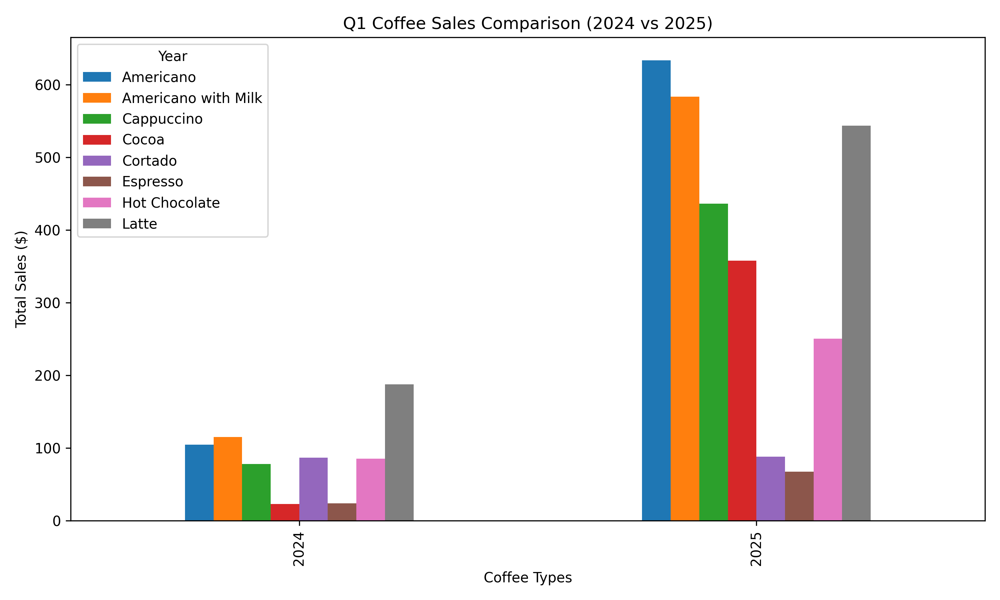
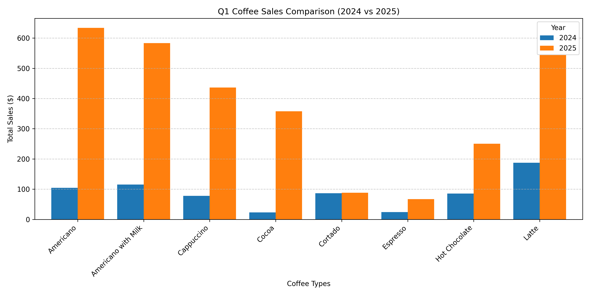
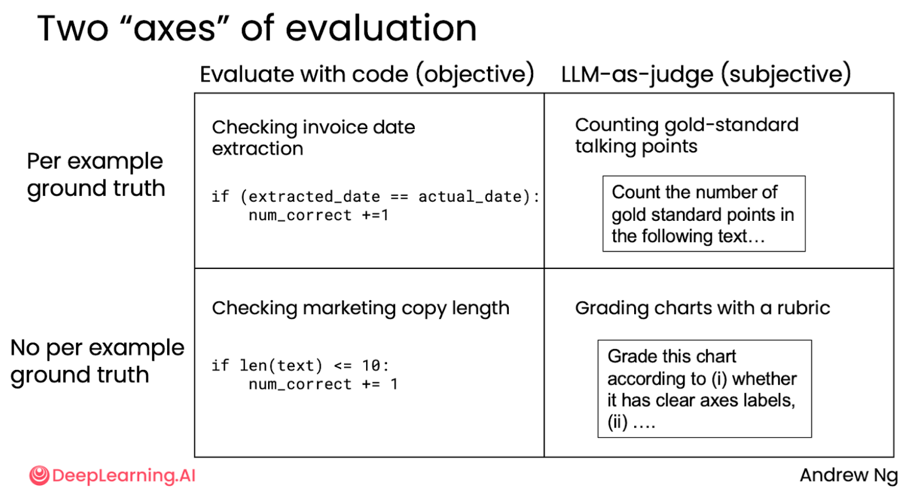

# Agentic AI — DeepLearning.AI (Coursera)

**Learner:** Md. Shahinur Hasan  
**Course:** [Agentic AI](https://www.coursera.org/learn/dlai-agentic-ai), taught by Andrew Ng, offered by DeepLearning.AI on Coursera  
**Completed:** 12 November 2026  
**Certificate:** [verify on Coursera](https://coursera.org/verify/6Y5PB94QAW4A) · [PDF](certificate/Agentic-AI-Certificate.pdf)

This repository holds my coursework for the course: graded programming assignments, ungraded labs, and the artifacts they produced. The course teaches how to build LLM systems that work through multi-step tasks rather than answering a single prompt. It covers four design patterns (reflection, tool use, planning and multi-agent collaboration), each built from first principles in Python before turning to frameworks. It also covers evaluation and error analysis, which is how these systems get improved.

<p align="center">
  
</p>

---

## Contents

- [Why this course](#why-this-course)
- [Projects](#projects)
- [Concepts covered](#concepts-covered)
- [Repository layout](#repository-layout)
- [Running the notebooks](#running-the-notebooks)
- [Acknowledgements](#acknowledgements)

---

## Why this course

My research interest is robust and trustworthy machine learning. Agentic systems are a natural place to study this: an LLM that plans, calls tools and runs code has a much larger failure surface than a single prediction. Errors compound across steps, tool outputs can be wrong or adversarial, and the end-to-end behavior is hard to evaluate. The course's emphasis on **systematic evaluation, component-level error analysis, and safe code execution** is the part most relevant to that interest. For the Module 2 assignment, I chose *An Introduction to Adversarial Machine Learning* as the topic for the reflective writing workflow.

---

## Projects

Graded assignments are marked **(graded)**. In these, I implemented the core functions inside a course-provided scaffold, and all of them passed the course's unit tests. The ungraded labs are guided notebooks that I worked through and experimented with.

### Module 1 — Introduction to agentic workflows
Conceptual module (quiz and an interactive app item, no programming notebook). Covered task decomposition, the autonomy spectrum, and the case studies used throughout the course: invoice processing, customer-service agents and research/report writing.

### Module 2 — Reflection

| Project | What it does | Files |
|---|---|---|
| **Reflective writing workflow** (graded) | Three-stage pipeline: `generate_draft` (GPT-4o) → `reflect_on_draft` (a separate critic model) → `revise_draft`. The critic reviews structure, clarity, argument strength and tone, and the reviser rewrites the draft against that critique. Tested on an essay about adversarial machine learning. | [`Module-02/assignment/`](Module-02/assignment/) |
| **Chart-generation agent with multimodal reflection** | The LLM writes matplotlib code from a natural-language request. The code is executed, a vision-capable model critiques the *rendered image*, and the code is regenerated. | [`M2_UGL_1.ipynb`](Module-02/M2_UGL_1.ipynb) |
| **SQL generation with reflection** | Natural-language questions are turned into SQL over a SQLite product database. The query is refined first by self-critique alone, then by reflection that uses *external feedback*: the actual query results. | [`M2_UGL_2.ipynb`](Module-02/M2_UGL_2.ipynb), [`products.db`](Module-02/products.db) |

Example of reflection on a chart. The first version groups bars by year, which makes the per-product comparison hard to read. After critiquing the rendered image, the agent regroups by product, rotates the labels and adds gridlines:

| V1 (direct generation) | V2 (after reflection) |
|---|---|
|  |  |

### Module 3 — Tool use

| Project | What it does | Files |
|---|---|---|
| **Tool-using research agent** (graded) | `generate_research_report_with_tools`: a hand-written tool-calling loop (bounded by `max_turns`) that lets the model call **arXiv** and **Tavily web search**, appends each tool result to the conversation, and stops when the model returns a final answer. `reflection_and_rewrite` produces a structured critique (Strengths / Limitations / Suggestions / Opportunities) and a revised report as **validated JSON**. `convert_report_to_html` renders the final report. | [`C1M3_Assignment.ipynb`](Module-03/C1M3_Assignment.ipynb), [`research_tools.py`](Module-03/research_tools.py) |
| **Turning functions into tools** | Exposing Python functions as LLM tools with AISuite. Covers automatic schema generation from function signatures, writing JSON tool schemas by hand, inspecting the model's tool-call requests, and giving the model several tools at once. | [`M3_UGL_1.ipynb`](Module-03/M3_UGL_1.ipynb) |
| **Email assistant agent** | An agent that manages an inbox through a simulated REST email service (FastAPI + SQLite): listing, reading, searching, sending and deleting emails. It shows how the agent behaves when a needed tool (`delete_email`) is missing, and how it recovers once the tool is added. | [`M3_UGL_2.ipynb`](Module-03/M3_UGL_2.ipynb), [`email_tools.py`](Module-03/email_tools.py) |

### Module 4 — Practical tips for building agentic AI (evaluation)

| Project | What it does | Files |
|---|---|---|
| **Component-level evaluation of a research agent** | Isolates the web-search step (`find_references`) of a research workflow and scores it with an objective, code-based metric: the share of returned sources that come from a list of preferred, trusted domains. This lets the retrieval step be tuned without rerunning and judging the whole pipeline. | [`M4_UGL_1.ipynb`](Module-04/M4_UGL_1.ipynb) |

<p align="center"><br><sub>The 2×2 framework of evaluation types used in the course (slide © DeepLearning.AI).</sub></p>

### Module 5 — Patterns for highly autonomous agents (planning and multi-agent)

| Project | What it does | Files |
|---|---|---|
| **Multi-agent research pipeline** (graded) | A `planner_agent` turns a topic into an ordered list of executable steps. An executor routes each step to a specialist: a `research_agent` (arXiv, Tavily and Wikipedia tools), a `writer_agent` (academic drafting) or an `editor_agent` (critique and revision). The result is a complete Markdown research report. | [`C1M5_Assignment.ipynb`](Module-05/C1M5_Assignment.ipynb) |
| **Customer-service agent: planning with JSON plans** | For a retail store, the LLM produces a structured plan of tool calls over DuckDB inventory and transaction tables. The plan is executed step by step, followed by a reflection step and an error-explanation step. | [`M5_UGL_1.ipynb`](Module-05/M5_UGL_1.ipynb), [`inventory_utils.py`](Module-05/inventory_utils.py) |
| **Customer-service agent: planning with code as action** | The same task, but the LLM writes Python that is executed directly against a TinyDB store (e.g. *"return two aviator sunglasses"*). This illustrates the trade-off between the flexibility of code and the predictability and safety of constrained JSON plans. | [`M5_UGL_1_R.ipynb`](Module-05/M5_UGL_1_R.ipynb), [`store_db.json`](Module-05/store_db.json) |
| **Market-research team (multi-agent)** | A linear pipeline of specialist agents (market researcher with web search, graphic designer with image generation, copywriter and packaging agent) that produces a summer sunglasses campaign: trend analysis, a generated product image and an executive summary. | [`M5_UGL_2.ipynb`](Module-05/M5_UGL_2.ipynb), [`campaign_summary_*.md`](Module-05/), [`generated_image.png`](Module-05/generated_image.png) |

---

## Concepts covered

### Foundations of agentic workflows
- What makes a system *agentic*. Autonomy as a **spectrum**, from fixed, hand-coded pipelines to highly autonomous agents, rather than a binary label.
- Why multi-step workflows outperform single-prompt (zero-shot) generation, even with the same underlying model.
- **Task decomposition**: breaking a real business process into discrete steps that an LLM, a tool or a human can carry out.
- Case studies: invoice processing, customer-service agents, research and report-writing systems.
- Where human review fits into a workflow.
- Performance benefits of agentic designs: parallel sub-tasks, modular and swappable components.

### Reflection
- Direct generation compared with generate → critique → revise loops.
- Writing reflection prompts against **explicit criteria**, and using a different model as the critic.
- **Reflection with external feedback**: error messages, execution output and query results, which give much larger gains than self-critique alone.
- **Multimodal reflection**: critiquing a rendered chart image rather than the code that produced it.
- Measuring the gain from reflection with evals (e.g. SQL accuracy before and after reflection).
- Recognizing which tasks benefit most from reflection.

### Tool use
- What a *tool* is in an agentic system, and how the LLM decides when to request one.
- From older marker-based approaches (parsing special tokens in text) to **native function calling**.
- Tool schemas: generated automatically from function signatures, or written by hand in JSON.
- The tool-calling loop: detect the call → execute → return the result to the model → repeat, with a turn limit.
- Composing several tools in one task (web search, arXiv, Wikipedia, email, databases).
- **Code execution as a tool**, and the need to sandbox it (e.g. Docker).
- Unified multi-provider clients (AISuite) and switching models across providers.
- **Model Context Protocol (MCP)**: a standard interface between agents and external tools and data sources.

### Evaluation and error analysis
- Building evals early and iterating: the **build-versus-analyze** loop.
- **Error analysis** by reading traces and tallying which component causes each failure.
- **End-to-end vs. component-level** evaluation, and when each is worth the cost.
- The 2×2 framework: **objective (code-based) vs. subjective (LLM-as-judge)** evaluation, crossed with **per-example ground truth vs. none**.
- Metrics such as precision, recall and F1 for retrieval and extraction steps.
- Improving LLM components (prompt design, model choice, provider swaps) and non-LLM components (search parameters, hyperparameters).
- Balancing **quality, latency and cost**; benchmarking before production deployment.

### Planning
- LLM-generated plans that orchestrate tools and data sources.
- **JSON plans** (structured, validated, predictable) vs. **code as action** (flexible and expressive, but needs sandboxing).
- Executing plans step by step, reflecting on the results and explaining failures.

### Multi-agent systems
- Splitting work across specialized agents with their own roles, prompts and tools.
- Communication patterns: **linear pipelines**, **hierarchical manager–worker** setups and **all-to-all** messaging.
- Planner / executor architectures that route steps to specialist agents.
- Applying autonomous agents responsibly in real projects.

---

## Repository layout

```
Agentic-AI/
├── certificate/                 Course certificate (PDF and preview image)
├── Module-02/  Reflection
│   ├── assignment/              Graded: reflective writing workflow (+ its utils/tests)
│   ├── M2_UGL_1.ipynb           Chart generation with multimodal reflection
│   ├── M2_UGL_2.ipynb           SQL generation with reflection
│   ├── *_v1.png / *_v2.png      Charts before and after reflection
│   └── utils.py, products.db, requirements.txt
├── Module-03/  Tool use
│   ├── C1M3_Assignment.ipynb    Graded: tool-using research agent
│   ├── M3_UGL_1.ipynb           Turning functions into tools
│   ├── M3_UGL_2.ipynb           Email assistant agent
│   └── research_tools.py, email_tools.py, display_functions.py, Dockerfile
├── Module-04/  Evaluation
│   └── M4_UGL_1.ipynb           Component-level eval of a research agent
└── Module-05/  Planning and multi-agent systems
    ├── C1M5_Assignment.ipynb    Graded: planner + research/writer/editor agents
    ├── M5_UGL_1.ipynb           Customer-service agent (JSON plans, DuckDB)
    ├── M5_UGL_1_R.ipynb         Customer-service agent (code as action, TinyDB)
    ├── M5_UGL_2.ipynb           Market-research multi-agent team
    └── campaign_summary_*.md, generated_image.png, store_db.json, *_utils.py
```

**Tools and libraries:** Python, Jupyter, OpenAI API, AISuite, Tavily, arXiv API, Wikipedia API, SQLite, DuckDB, TinyDB, FastAPI, pandas, matplotlib, Docker.

---

## Running the notebooks

The notebooks were written for the Coursera lab environment. That environment routes OpenAI calls through a DeepLearning.AI proxy, configured by `usercustomize.py`, and has the course's helper modules on the path. To run them locally:

```bash
pip install -r Module-02/requirements.txt aisuite tavily-python wikipedia arxiv duckdb tinydb
```

Then create a `.env` file (excluded by `.gitignore`) with your own keys:

```env
OPENAI_API_KEY=...
TAVILY_API_KEY=...
```

Open a notebook from inside its module folder so its helper modules import correctly. Some notebooks call course-only services and graders, so not every cell will run outside Coursera.

---

## Acknowledgements

Course content, lab scaffolding, helper modules, datasets and slide images are © [DeepLearning.AI](https://www.deeplearning.ai/). They are included here only to document my coursework. My own contributions are the implementations in the graded exercises (the `### START CODE HERE ###` blocks), my experiments in the labs, and the outputs they produced. Thanks to Andrew Ng and the DeepLearning.AI team for the course.
