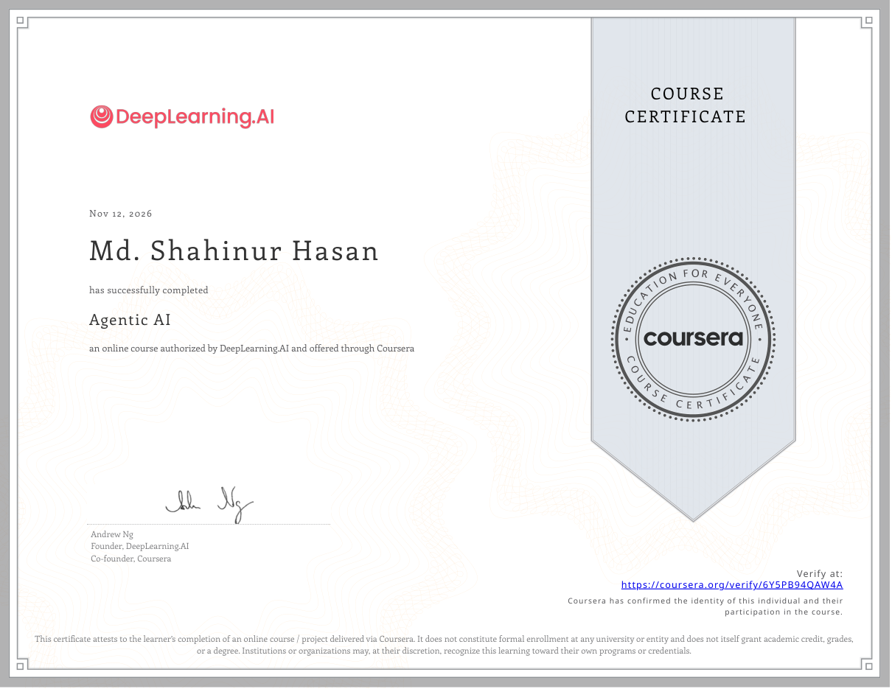

# Agentic AI — DeepLearning.AI

  
   
  <a href="https://coursera.org/verify/6Y5PB94QAW4A">Verify certificate on Coursera</a>

## Projects

| Project | Pattern | Description |
|---|---|---|
| Reflective Writing Workflow | Reflection | Three-stage generate → critique → revise pipeline in which a separate critic model reviews a draft for structure, clarity and argument strength before a final revision. |
| [Chart Generation Agent](Module-02/M2_UGL_1.ipynb) | Reflection | Generates matplotlib code from natural-language requests, executes it, and refines the code based on a vision model's critique of the rendered chart. |
| [SQL Query Agent](Module-02/M2_UGL_2.ipynb) | Reflection | Translates questions into SQL over a SQLite database and improves queries using external feedback from execution results. |
| Tool-Using Research Agent | Tool use | Function-calling loop over arXiv and Tavily web search that produces a cited research report, followed by structured JSON reflection, revision and HTML rendering. |
| [Function-to-Tool Integration](Module-03/M3_UGL_1.ipynb) | Tool use | Exposes Python functions as LLM tools through automatic and hand-written JSON schemas, including multi-tool use. |
| [Email Assistant Agent](Module-03/M3_UGL_2.ipynb) | Tool use | Agent that reads, searches, sends and deletes emails through a simulated REST service (FastAPI, SQLite). |
| [Component-Level Evaluation](Module-04/M4_UGL_1.ipynb) | Evaluation | Isolates the web-search step of a research workflow and scores it with an objective, code-based source-quality metric. |
| Multi-Agent Research Pipeline | Planning, multi-agent | A planner decomposes a topic into executable steps that an executor routes to research, writer and editor agents, producing a complete Markdown report. |
| [Customer Service Agent — JSON Plans](Module-05/M5_UGL_1.ipynb) | Planning | Generates structured plans of tool calls over DuckDB inventory data, with reflection and error-explanation steps. |
| [Customer Service Agent — Code as Action](Module-05/M5_UGL_1_R.ipynb) | Planning | Generates and executes Python directly against a TinyDB store, contrasting the flexibility of code with the predictability of JSON plans. |
| [Market Research Team](Module-05/M5_UGL_2.ipynb) | Multi-agent | Pipeline of research, graphic-design, copywriting and packaging agents that produces a product campaign with trend analysis, generated imagery and an executive summary. |

## Modules

| Module | Topic | Summary |
|---|---|---|
| 1 | Introduction to Agentic Workflows | Agentic systems as a spectrum of autonomy; task decomposition; applications in invoice processing, customer service and research. |
| 2 | Reflection | Improving outputs through self-critique and external feedback, including multimodal reflection and evaluation of the gains. |
| 3 | Tool Use | Function calling, tool-execution loops, safe code execution and the Model Context Protocol (MCP). |
| 4 | Practical Tips for Building Agentic AI | Evaluation design, error analysis, component-level tuning, and trade-offs between quality, latency and cost. |
| 5 | Patterns for Highly Autonomous Agents | Planning with JSON and code, multi-agent collaboration and communication patterns. |

## Key Concepts

**Agentic Workflows**
- Autonomy as a spectrum, from fixed pipelines to fully autonomous agents
- Task decomposition of real-world processes into LLM, tool and human steps
- Parallelism and modularity as performance advantages over single-prompt generation

**Reflection**
- Generate → critique → revise loops against explicit criteria
- Reflection with external feedback such as execution output and error messages
- Multimodal reflection on rendered outputs
- Quantifying improvements from reflection through evaluation

**Tool Use**
- Native function calling and tool schemas
- Tool-execution loops with bounded iteration
- Code execution as a tool and sandboxing
- Model Context Protocol (MCP) for standardized tool and data access
- Multi-provider model access through a unified interface (AISuite)

**Evaluation and Error Analysis**
- Build-versus-analyze iteration cycle
- Trace-based error analysis to locate failing components
- End-to-end versus component-level evaluation
- Objective (code-based) versus subjective (LLM-as-judge) evaluation, with and without per-example ground truth
- Precision, recall and F1 for retrieval and extraction
- Optimizing prompts, models, providers and non-LLM components under quality, latency and cost constraints

**Planning**
- LLM-generated plans that orchestrate tools and data sources
- JSON plans versus code as action: flexibility, security and predictability trade-offs

**Multi-Agent Systems**
- Specialized agents with distinct roles, prompts and tools
- Linear, hierarchical (manager–worker) and all-to-all communication patterns
- Planner–executor architectures
